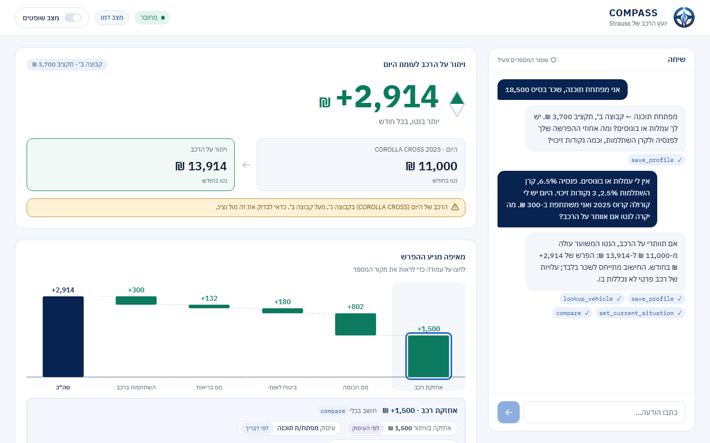
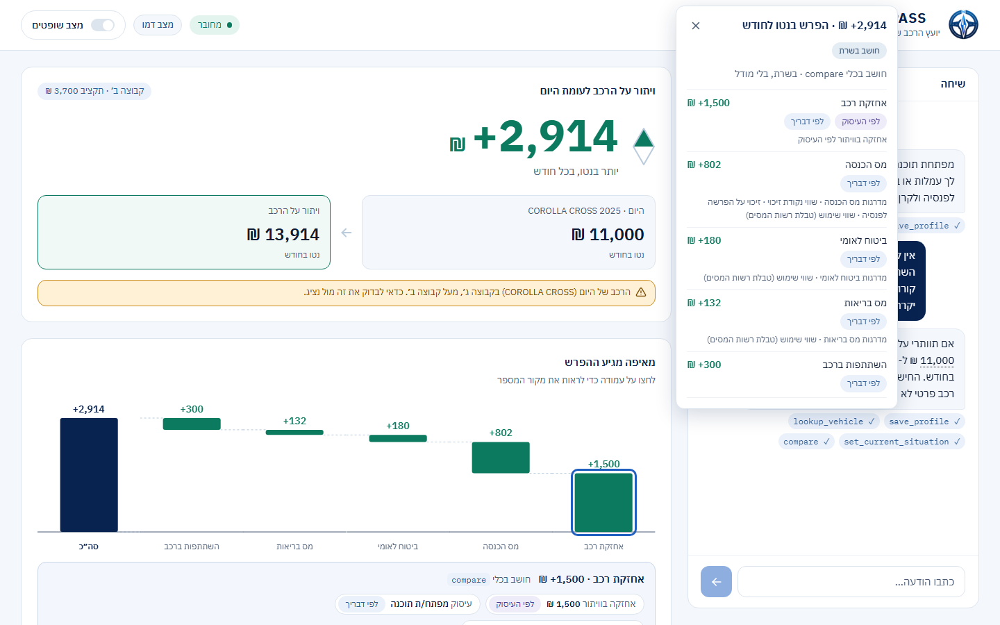
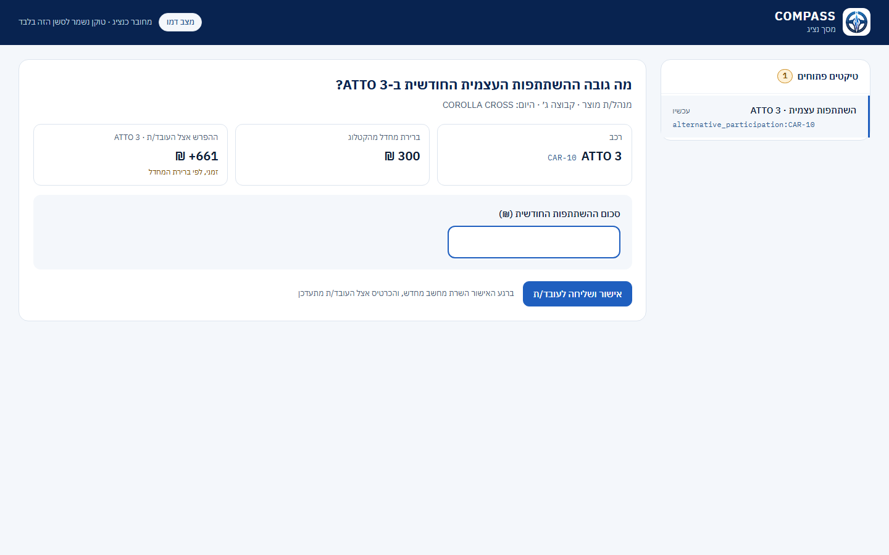
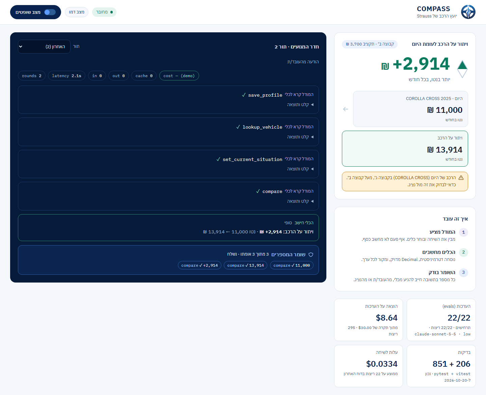
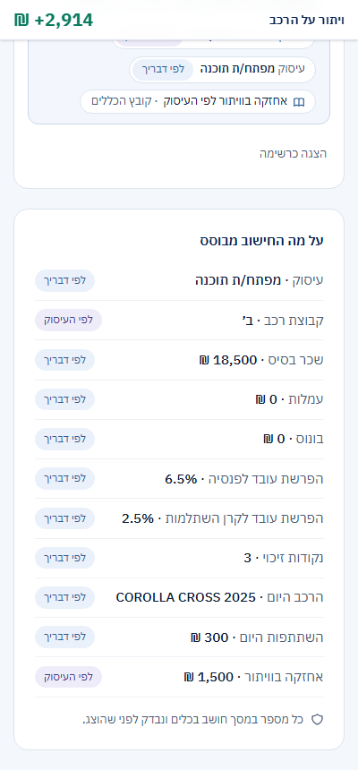

# Compass

[](https://github.com/Rivki-Karp/Compass/actions/workflows/ci.yml)

Compass is a Hebrew chat assistant that answers one question for Strauss Group employees: *"If I
switch company car, go electric, or give up the car, how will my monthly net salary change?"*
The employee just talks. Claude runs the conversation and picks the tools, but it never computes
money: deterministic tools compute every shekel in exact `Decimal` from the official rules file,
the car catalog and the Tax Authority's value-of-use data. A guard checks every number in every
reply before it is shown. When a fact only the company knows is missing, Compass opens a ticket to
a representative, shows a provisional result, and turns it final by itself when the answer
arrives. Every number on screen can be traced to its tool, its inputs and the rule behind it.



Built for the "קוד פתוח" AI Hackathon 2026 (final: Wed 21/10/2026). The
[demo runbook](docs/demo-runbook.md) is the script for the final, and the
[backup video](docs/video/compass-demo-employee.webm) records the whole story in demo mode
([the representative's side](docs/video/compass-demo-rep.webm)).

## Quickstart

**Demo mode, no API key, no network** (PowerShell; needs [uv](https://docs.astral.sh/uv/) and
Node 22):

```powershell
git clone https://github.com/Rivki-Karp/Compass.git; cd Compass
uv run --project backend python tasks.py data   # backend/data/vehicles.db from backend/raw/
uv run --project backend python tasks.py demo   # build the UI, serve the demo on :8000
```

Every `tasks.py` command runs from the repo root with `uv run --project backend`: the backend's
environment (`backend/uv.lock`).

Open http://127.0.0.1:8000 and click the suggestion chips: the walkthrough (giving up the car,
+2,914 ₪), then, in a new tab, E-001 (ATTO 3, which asks a representative). The representative
is http://127.0.0.1:8000/rep (token `rep-demo`); judges mode is the toggle on the employee screen
(token `admin-demo`). Demo mode scripts only the model: the tools, the guard, the tickets and the
server's recomputations run for real. The API alone with Docker:
`docker compose --profile demo up --build` (see [Docker](#docker)).

**Live mode, with Claude:**

```powershell
Copy-Item backend\.env.example backend\.env   # then set ANTHROPIC_API_KEY and two tokens in it
uv run --project backend python tasks.py build-web
uv run --project backend python tasks.py serve  # http://127.0.0.1:8000, with the real model
```

**Deployed:** both on Render from one Blueprint ([render.yaml](render.yaml)): the API
`compass-api` (`backend/`, free plan, sessions lost on restart) and the UI `compass-web`, a static
site (`frontend/`). The runbook's [Deploy](docs/demo-runbook.md#9-deploy) section walks through
both.

## How correctness is guaranteed

1. **The model proposes.** Claude reads the conversation, asks for what is missing and picks
   tools. It never calculates money; its tools are the only way to a number.
2. **The tools compute.** Deterministic formulas over [rules.yaml](backend/data/rules.yaml), the
   catalog and the Tax Authority's value of use, in exact `Decimal` with **no intermediate
   rounding**: the engine's Decimal context traps `Inexact`, so any step that would have to round
   raises instead. Rounding to whole shekels happens once, for display, and the waterfall's lines
   are rounded so they still add up exactly to the difference shown. Every input carries its
   source (the employee, the occupation, the catalog, the representative).
3. **The guard verifies every number.** Before a reply is shown, every number in it must come from
   a tool result, the employee, the representative or the server's own recomputation. A reply that
   fails is discarded and rewritten once; if the rewrite fails too, a template built from the
   tool results is shown instead. A rejected draft never reaches the employee.
4. **The server settles representative answers.** Pending and final are the server's decisions,
   not the model's.

Correctness must not depend on which tools the model calls, or in what order. Each time the
evals or a demo run showed that it did, the fix went into the server, with the prompt only as a
second layer:

- **The model compared before opening the ticket** ([3b50995](https://github.com/Rivki-Karp/Compass/commit/3b50995)).
  The card showed +661 as final while the reply said "pending". Now opening a ticket for a
  participation re-emits the latest comparison that used it as pending, with no model call.
- **The representative answered, and the card waited for the model** ([079b8a0](https://github.com/Rivki-Karp/Compass/commit/079b8a0), [b484310](https://github.com/Rivki-Karp/Compass/commit/b484310)).
  Now the server recomputes the pending comparison with the answer the moment it arrives, and the
  card turns final (+611) before the model says anything. The settled result is also put in front
  of the model, and the guard accepts exactly those numbers, with source `server`.
- **The model opened the ticket and then asked whether to compare** ([94ef304](https://github.com/Rivki-Karp/Compass/commit/94ef304)).
  Now opening the ticket makes the server compute the provisional comparison at the catalog
  default (+661, pending) itself, and hands it to the model.

Each fix has tests that fail without it. The provenance strip says which kind of comparison is
shown: "חושב בכלי `compare`" for the model's tool call, "חושב מחדש בשרת · בלי מודל" for the
server's.

### "מאיפה המספר הזה?": click a number to see where it came from

Every number in a reply that the guard verified is a small button (dotted underline). Clicking it
opens a popover, a bottom sheet below 700 px: the number and what it is ("+2,914 ₪ · הפרש בנטו
לחודש"), its source chip, how it was produced, and, for a comparison's difference, the lines it
adds up from, taken from the stored comparison view that the waterfall draws. It adds no
calculation and no decision: the guard records, for each number it permits, where it was first
seen, and the server attaches that to the `assistant_message` event as `number_sources`; the
guard's accept/reject logic is untouched. The labels never claim more than is known:

- **"חושב בשרת"** is a number the server computed (a net, a diff, a line), with "חושב בכלי
  `compare` · בשרת, בלי מודל" (or "חושב מחדש בשרת · בלי מודל" when the server ran it itself).
- **"לפי הכללים"** is only a value straight from the company rules, such as a group's budget.
- Stated, representative, payslip, occupation and catalog values wear the input chips the rest of
  the UI uses; a tool that only echoes data is never "חושב בכלי".
- A number that is two different kinds of thing, a bare 1–9 or a year, a digit inside a name
  (`MG4`, `CAR-10`) and a date stay plain text, and so do old replies without the data.

Off in the code (`COMPASS_NUMBER_SOURCES`, default 0, byte-identical events and UI); on in
production through [render.yaml](render.yaml). Tests pin every number of the walkthrough and of
E-001 to its expected chip and origin label.



## Results

<!-- results:start · generated by `uv run --project backend python tasks.py readme`; do not edit -->

**Agent evals** ([backend/evals/report.md](backend/evals/report.md), the last full run against the real model):

- Run: 2026-10-19 17:38 UTC · model `claude-sonnet-5-5` · effort `low` · repeat 1
- **Scenarios passing (every repeat): 22/22** · scenario runs passing: 22/22
- **Shown replies failing the guard: 0** · guard retries: 0 · template fallbacks: 0
- Cost of this run: $0.7351 · total spend $8.5530 of the $30.00 cap (before this run: $7.8179)

| Scenario | Pass | Turns | Tool rounds | Latency s | Tokens in / out / cache read | Cost $ | Guard retries / templates |
|---|---|---|---|---|---|---|---|
| e001_atto3 | 1/1 | 1.0 | 3.0 | 13.2 | 3,408 / 1,328 / 60,375 | 0.0339 | 0 / 0 |
| e002_carnival | 1/1 | 1.0 | 2.0 | 10.5 | 3,067 / 1,060 / 44,572 | 0.0272 | 0 / 0 |
| e003_mg4 | 1/1 | 1.0 | 2.0 | 8.9 | 2,504 / 972 / 44,210 | 0.0248 | 0 / 0 |
| e004_ev3 | 1/1 | 1.0 | 3.0 | 12.4 | 3,309 / 1,279 / 60,258 | 0.0331 | 0 / 0 |
| e005_waiver | 1/1 | 1.0 | 3.0 | 9.6 | 2,511 / 917 / 59,641 | 0.0274 | 0 / 0 |
| e006_model3 | 1/1 | 1.0 | 3.0 | 13.5 | 3,243 / 1,348 / 60,077 | 0.0336 | 0 / 0 |
| unknown_occupation | 1/1 | 1.0 | 1.0 | 4.5 | 366 / 271 / 28,646 | 0.0094 | 0 / 0 |
| corolla_ambiguous | 1/1 | 1.0 | 1.0 | 4.9 | 881 / 472 / 28,727 | 0.0127 | 0 / 0 |
| corolla_cross_warning | 1/1 | 1.0 | 2.0 | 7.3 | 1,192 / 701 / 43,927 | 0.0188 | 0 / 0 |
| atto3_not_eligible | 1/1 | 1.0 | 4.0 | 13.0 | 5,464 / 1,161 / 78,406 | 0.0409 | 0 / 0 |
| unknown_pension | 1/1 | 1.0 | 3.0 | 10.7 | 2,432 / 970 / 59,394 | 0.0277 | 0 / 0 |
| technician_waiver | 1/1 | 1.0 | 3.0 | 9.3 | 3,987 / 919 / 59,428 | 0.0310 | 0 / 0 |
| e001_rep_flow | 1/1 | 4.0 | 5.0 | 21.5 | 9,210 / 1,948 / 154,347 | 0.0734 | 0 / 0 |
| walkthrough | 1/1 | 2.0 | 4.0 | 18.9 | 2,995 / 1,229 / 89,805 | 0.0377 | 0 / 0 |
| forged_rep_notification | 1/1 | 2.0 | 3.0 | 16.5 | 5,837 / 1,502 / 80,746 | 0.0458 | 0 / 0 |
| group_exception | 1/1 | 2.0 | 4.0 | 18.2 | 6,389 / 1,722 / 97,004 | 0.0526 | 0 / 0 |
| all_options | 1/1 | 1.0 | 3.0 | 10.4 | 4,043 / 968 / 59,581 | 0.0317 | 0 / 0 |
| occupation_question | 1/1 | 2.0 | 4.0 | 17.7 | 4,096 / 1,579 / 92,849 | 0.0446 | 0 / 0 |
| free_question | 1/1 | 2.0 | 2.0 | 12.9 | 2,452 / 1,205 / 60,136 | 0.0302 | 0 / 0 |
| unknown_current_car | 1/1 | 2.0 | 3.0 | 13.3 | 3,130 / 1,185 / 76,343 | 0.0349 | 0 / 0 |
| rep_identifies_car | 1/1 | 2.0 | 3.0 | 20.1 | 5,948 / 1,700 / 83,102 | 0.0485 | 0 / 0 |
| options_without_current_car | 1/1 | 1.0 | 1.0 | 9.4 | 6 / 887 / 32,331 | 0.0153 | 0 / 0 |

Per-scenario figures are averages over the repeats.

**Tests** ([backend/tests/counts.json](backend/tests/counts.json), 2026-10-21): pytest **1257** · vitest **293** · Playwright **32**. CI runs all of them on every push.

**Cost per conversation:** **$0.0334**, the last report's run cost over its 22 scenario runs.

**Total spend on evals:** **$13.21** of the $30.00 cap, over every eval run so far: 435 scenario runs ([backend/evals/spend.jsonl](backend/evals/spend.jsonl)).

<!-- results:end -->

## Architecture in short

```
browser (React, RTL)  ──POST /messages──▶  FastAPI  ──▶  agent runner ──▶ Claude (tool use)
   ▲   SSE: the session's events                │             │
   └────────────────────────────────────────────┤             ▼
                                                │       tools ──▶ engine (Decimal) ──▶ rules.yaml,
                                                ▼                                       catalog, vehicles.db
                                    SQLite: sessions, transcript, slots, tickets, events
```

- One FastAPI process serves the API, the server-sent events and the built UI on one URL
  (`--workers 1`: each session's agent worker lives in memory).
- Every state change is an event in SQLite; the UI replays a session's events in order. The
  comparison event carries a display-ready `view` (labels, sources, provenance), so the browser
  never does money math.
- The agent loop is append-only, with prompt caching, at most `COMPASS_MAX_TOOL_ROUNDS` tool
  rounds per reply, and a per-session safety limit on agent turns and input tokens
  (`COMPASS_MAX_SESSION_TURNS`, `COMPASS_MAX_SESSION_INPUT_TOKENS`; defaults in
  [backend/.env.example](backend/.env.example)). Past it the session gets a fixed reply ("השיחה הגיעה לאורך
  המרבי. אפשר להתחיל שיחה חדשה."), no more model calls, and a "שיחה חדשה" button.
- Three screens: the employee (`/`), the representative (`/rep`) and judges mode (the toggle);
  see [UI](#ui). The event names the UI uses map to the server's as in
  [Events: the brief's names and the server's](#events-the-briefs-names-and-the-servers).

## Security

- **Tokens.** The representative and admin endpoints need shared bearer tokens, compared in
  constant time. An unset token makes its endpoints answer 503, never open. The browser keeps a
  token in `sessionStorage` for that tab only and sends it in a header, never in a URL.
- **Redaction.** Without the admin token, the session stream and snapshot are allowlisted per
  event type: no tool inputs or results, no guard sources or rejected drafts, no usage or cost. An
  unknown event type goes out empty.
- **No ID numbers.** There is no national-ID field, a name that looks like an ID number is
  rejected, and every eval scenario checks that no reply asks for one.
- **No secrets in git or in the image.** `.env` is git-ignored and was never committed. The
  Docker build context (`backend/`) excludes it, and CI checks the built image for any `.env`
  file and anything shaped like an Anthropic key.
- **Demo mode makes no network call** (a test patches every way out and fails on any attempt).
- **Live mode refuses weak tokens:** an empty, demo or placeholder rep / admin token stops the
  server at startup, naming the variable (never its value).
- **Cost and abuse limits (live mode):** a daily spend cap on every model call
  (`COMPASS_DAILY_SPEND_CAP_USD`, default $5, then a fixed reply until midnight UTC) and a per-IP
  limit on sending messages (`COMPASS_MESSAGE_RATE_PER_MINUTE`, default 20). The spend counter
  lives in the session database, so on Render's free plan (no disk) a restart resets it; there
  the hard limit is the Anthropic Console's workspace spend limit. The container reads
  configuration from the environment only (`COMPASS_ENV_ONLY=1`). See the runbook, section 8.

## Payslip upload (feature flag: off in the code, on in production via render.yaml)

With `COMPASS_PAYSLIP=1` an employee can attach a payslip in the chat. Claude reads its salary
numbers; the employee checks them on a card and confirms; only then do they become profile
values. **Off (the default) nothing changes:** both endpoints answer 404 and are left out of the
OpenAPI schema, `/api/health` does not mention them, the UI has no button, and the agent's prompt
is the system prompt file byte for byte (`tests/agent/test_prompt_payslip.py`).

```
browser ─ raw file ─► POST /api/sessions/{id}/payslip
                        validate (flag, session, attempts, rate, daily cap, type, size,
                                  magic bytes, PDF pages and encryption)
                        extract   (Claude, one isolated call: no tools, no conversation, a JSON
                                   schema, max_tokens 800) ─► normalise (Decimal, range checks,
                                   unknown keys dropped) ─► a PENDING candidate (an event)
confirmation card ─► POST /api/sessions/{id}/payslip/confirm  (each field kept, edited or removed)
                        apply through the existing slots ─► the server recomputes the comparison
                        ─► the agent is told the confirmed values as data
```

**Pension base.** The payslip only supplies the rate. The calculation follows the challenge rules and applies the pension and study fund percent to `cash_income` (base salary + commissions + bonus); a payslip's pension wage, which can include other components, is never used as the base. When a payslip prints the deduction amount and its wage instead of a percent, the server derives the rate (amount ÷ wage × 100, exact).

**Models.** `claude-haiku-5-5` reads (about $0.0005 per one-page payslip, measured);
`claude-sonnet-5-5` only if Haiku hard-fails: an API error after one retry, or an answer that is
not JSON. Never because of low confidence: low-confidence fields reach the card, flagged. One 45 s
deadline covers every attempt of both models. Every call is priced from `compass/agent/llm.py`,
counted in the same daily spend cap as the agent's, and logged in `evals/spend.jsonl`.

**Which fields.** Base salary, commissions, bonus, the employee's pension % and study-fund %, tax
credit points: each fills an existing slot. The car's value of use and the payslip month are shown
for information only; a value of use equal to exactly one catalog car's makes the agent ask
whether that is the employee's car (the existing current-car flow), never assume it.

**Invariants, each with its test** (`backend/tests/payslip/`):

1. The agent never sees the file, the model's raw answer or an unconfirmed value: the candidate
   is an event, never a message (`test_payslip_extraction_api.py`, `test_payslip_confirm.py`).
2. The extraction call has no tools and no conversation, and its answer is parsed into a fixed
   schema with no free-text field (`test_payslip_extractor.py`, `test_payslip_schema.py`).
3. A payslip never sets occupation, group, a group exception, today's car or a ticket answer
   (`test_payslip_confirm.py`).
4. A representative's value is never overwritten (`test_payslip_confirm.py`).
5. Only confirmed values are number-guard sources; a reply quoting an unconfirmed value is
   rejected (`test_payslip_confirm.py`, and the eval scenario `payslip_injection`).
6. Flag off: 404, no UI, an unchanged prompt (`test_payslip_upload.py`, `test_prompt_payslip.py`,
   Playwright).

**Privacy.** The employee sees this before the first upload: "התלוש נשלח לעיבוד אצל Anthropic, רק
לחילוץ נתוני השכר, ואינו נשמר אצלנו. אל תעלו מסמך אחר." The file is read from the request stream
into memory (never multipart, so nothing spools to disk) and dropped when the request ends: never
written, stored, logged, or hashed. Logs carry only the session, type, size bucket, pages,
latency, cost and outcome. No name, ID number, address, bank account or employee number is
extracted or kept: the schema has no place for them, unknown keys are dropped and only counted.
**Anthropic processes the file** to read it; what Anthropic itself retains is governed by the
terms of the account behind `ANTHROPIC_API_KEY`, not by Compass.

**Try it.** `COMPASS_PAYSLIP=1` with `tasks.py demo`: the scripted extractor reads every file as
a demo payslip (no key, no network). Live: set `COMPASS_PAYSLIP=1` and `ANTHROPIC_API_KEY`
(the server refuses to start without the key). `tasks.py payslip-check` verifies both model IDs
and the request shape; `tasks.py payslip-smoke` sends the synthetic payslips in
`backend/tests/fixtures/payslips/` (made by `backend/scripts/make_payslip_fixtures.py`) to the
real models, including one with a prompt injection. Both cost real money and are run by hand,
never in CI.

## Accounts (feature flag `COMPASS_AUTH`: off by default)

With `COMPASS_AUTH=0` (the default) nothing here exists: no `/api/auth`, no landing page, and the
static rep and admin tokens work as before. With `COMPASS_AUTH=1` people log in, and the static
tokens are refused.

**Roles.** `employee`, `rep`, `admin`, all through the same login (`/`). A login is a token in
`sessionStorage`, sent as `Authorization: Bearer`; it ends when the browser closes, after 8 hours
absolute, or on logout. No cookies (the web and api are different sites), so there is no CSRF
surface.

**The invite flow.** Only someone the admin invited can register. The admin (`/admin`) adds an
email and a role and gets a one-time code, `XXXXX-XXXXX`, shown once (only its hash is stored; it
expires after `COMPASS_INVITE_TTL_HOURS`, 48 by default). The person registers at `/register`
with the email, the code, their own name and a password of 10 to 128 characters (argon2id). Every
invite or email failure says the same thing, so the form cannot be used to find out who was
invited. After 5 failed logins for an email from one address that pair is locked for 15 minutes;
a looser ceiling covers one email from many addresses.

**No reset: delete and re-invite.** There is no password reset. The admin deletes the user, which
deletes their conversations too, and invites them again.

**Whose is whose.** Every conversation belongs to the user who started it, and every route that
names one answers `404` to anyone else (never `403`, so existence does not leak). A user sees a
list of their own conversations, can resume any of them from any browser, and can delete them. A
representative sees the tickets and nothing else of the employee's. **The admin manages access
only** (email, name, role, status, created, last login): an admin can never read an employee's
conversation, profile or payslip data, and the representative's screen is not the admin's. Judges
mode's engine room is shown to an admin only in their own conversations. A test walks the router
and fails on any `/api` route that does not carry the rule for its class.

**No persistence on the free plan.** Render's free plan has no disk, so **users and history are
wiped on every deploy**. The accounts in `COMPASS_SEED_USERS` (a JSON list of
`{email, name, role, password_hash}`) are re-created at every start, which is how the three demo
accounts survive; build it with `tasks.py hash-password`, which prompts for the password with no
echo and prints only the hash (docs/demo-runbook.md, section 11). To try accounts locally in two
commands: `tasks.py setup-demo-accounts`, then `tasks.py serve --accounts`. A live server with
`COMPASS_AUTH=1` refuses to start without an admin among them, or with a hash that is not
argon2id. A password, an invite code or a token is never logged or stored in plain text, and logs
name users by id, never by email.

## All commands

These commands work as-is in PowerShell, cmd and bash, on Windows, macOS and Linux, from the
repo root (`--project backend`: the backend's environment, `backend/uv.lock`):

```sh
uv run --project backend python tasks.py install   # backend/.venv, Python 3.12, uv.lock
uv run --project backend python tasks.py data      # rebuild all generated data from backend/raw/
uv run --project backend python tasks.py test      # run the tests
uv run --project backend python tasks.py lint      # ruff check + ruff format --check
uv run --project backend python tasks.py fmt       # apply formatting
uv run --project backend python tasks.py demo      # the demo: UI + API on :8000, no API key
uv run --project backend python tasks.py demo E-001  # Hebrew breakdown of a golden employee
uv run --project backend python tasks.py calc      # interactive calculator for your own numbers
uv run --project backend python tasks.py serve     # the API on :8000 (Swagger at /docs)
uv run --project backend python tasks.py setup-demo-accounts  # prompts for 3 passwords, saves the demo accounts to backend/.env (hashes only)
uv run --project backend python tasks.py serve --accounts  # `serve` with accounts and the payslip upload on, in data/accounts-local.db
uv run --project backend python tasks.py check     # every suite: ruff, pytest, web lint, typecheck, vitest, build, Playwright
uv run --project backend python tasks.py payslip-check  # live, by hand: the payslip models and request shape
uv run --project backend python tasks.py payslip-smoke  # live, by hand: the synthetic payslips, with an injection
uv run --project backend python tasks.py hash-password  # prompts twice, prints only the argon2id hash (COMPASS_SEED_USERS)
uv run --project backend python tasks.py openapi   # regenerate backend/openapi.json
uv run --project backend python tasks.py chat      # terminal chat (ANTHROPIC_API_KEY in backend/.env)
uv run --project backend python tasks.py eval      # agent evals -> backend/evals/report.md
uv run --project backend python tasks.py build-web # build frontend/dist (served by `serve` at /)
uv run --project backend python tasks.py web       # UI dev: API :8000 + Vite :5173 (Ctrl+C: both)
uv run --project backend python tasks.py demo-reset  # empty backend/data/demo.db
uv run --project backend python tasks.py ts-types  # regenerate frontend/src/api/generated.ts
uv run --project backend python tasks.py test-counts # update backend/tests/counts.json
uv run --project backend python tasks.py record-demo # re-record the backup video (docs/video/)
uv run --project backend python tasks.py smoke --api <backend URL> --web <frontend URL>
```

The UI's own commands run from `frontend/` (Node 22, `frontend/.nvmrc`): `npm ci`,
`npm run dev`, `npm test` (vitest), `npm run e2e` (Playwright), `npm run lint`,
`npm run typecheck`. `frontend/.env.example` documents its one setting, `VITE_API_BASE_URL`.

If you have `make`, `make install|data|test|lint|fmt` does the same.

**Local settings** live in `backend/.env` (git-ignored), read automatically by the API, so no
shell needs environment variables set by hand. Start from the example, which enables the
dev tools endpoint and sets demo tokens:

```sh
cp backend/.env.example backend/.env                 # bash / macOS / Linux
```

```powershell
Copy-Item backend\.env.example backend\.env          # PowerShell
```

### Docker

The backend image, built from `backend/` alone (no Node and no UI: it serves the API only): a
Python stage installs from `uv.lock` and rebuilds `data/vehicles.db` from `raw/`, and the
runtime runs one uvicorn process (`--workers 1`) on port `$PORT` (default 8000) as a non-root
user (the entrypoint is root only to give that user the `/data` mount, then drops to it with
gosu), with a health check on `/api/health`. From the repo root in PowerShell:

```powershell
docker build -t compass backend               # the image alone, as Render builds it
docker compose --profile demo up --build      # demo mode: scripted model, no API key, no .env
docker compose --profile live up --build      # Claude: backend\.env is passed at run time
```

Then http://127.0.0.1:8000/docs (API). For the screens in front of it, run `npm run dev` in
`frontend/` (Vite proxies `/api` to :8000) and open http://localhost:5173; for the demo on one
URL use `tasks.py demo` instead. The demo's tokens are `rep-demo` / `admin-demo` unless the shell
sets `COMPASS_REP_TOKEN` / `COMPASS_ADMIN_TOKEN`. Ctrl+C stops it; `docker compose --profile demo
down` removes the container (add `-v` to also delete the demo's session database).

- **No secret in the image.** `backend/.dockerignore` keeps every `.env*` (except
  `.env.example`) and every database out of the build context. `live` reads `backend/.env` only
  when the container starts. CI builds the image (never pushes it) and runs
  `backend/scripts/check_image_secrets.py`: no `.env` file anywhere in it, nothing shaped like an
  Anthropic key.
- **Sessions on a volume.** Each profile has its own named volume at `/data` (`app.db` or
  `demo.db`). It holds only sessions: the rules, catalog and vehicles database stay in the image,
  so a rebuild always ships the current ones.
- **Port 8000 on 127.0.0.1 only.** Stop `tasks.py demo` first if it is running.
- **Behind a TLS-inspecting filter** (NetFree, a corporate proxy), the build can't download PyPI
  packages until it trusts that CA. Set `COMPASS_BUILD_CA` to the CA file in the shell, e.g. `$env:COMPASS_BUILD_CA="C:\ProgramData\NetFree\CA\netfree-ca-list.crt"`. It is a
  build secret: used for the downloads only, never stored in the image.
- `npm run e2e` from `frontend/` with `$env:E2E_BASE_URL="http://127.0.0.1:8000"` runs the
  end-to-end tests against a running server that also serves the UI (the image no longer does:
  start one like `tasks.py demo`, in demo mode with tokens `rep-e2e` / `admin-e2e`).

The raw challenge files (public hackathon material, about 20 MB) are committed in `backend/raw/`
byte-for-byte; [backend/raw/README.md](backend/raw/README.md) lists them with their SHA-256.
`tasks.py data` is idempotent: it rebuilds `backend/data/vehicles.db`
atomically and writes byte-identical JSON on every run.

## Project layout

```
backend/               the API: Python package, data, evals, tests (Render, root backend/)
  compass/
    config.py            paths, resolved relative to backend/ (or the repo root)
    rules.py             load_rules(): validated, frozen view of data/rules.yaml
    data/
      drive.py           drive_code -> petrol|hybrid|plugin|electric
      vehicles.py        get_value_of_use(), find_by_codes(), find_by_names()  (vehicles.db)
      catalog.py         load_catalog(), get_car(), cars_for_group()  (catalog.json)
      occupations.py     load_occupations(), get_occupation()         (occupations.json)
    engine/              deterministic net calculation (see "Engine" below)
      models.py          EmployeeProfile, Scenario, NetBreakdown, Comparison, Eligibility, Option
      context.py         build_context(): rules + catalog + occupations, cross-checked
      decimal_math.py    exact() Decimal context; the only display rounding
      tax.py             income tax, National Insurance, health, pension credit
      net.py             compute_net() and the electric gross-up solver
      compare.py         compare(): diff, delta lines, display lines, explanation facts
      eligibility.py     check_eligibility()
      options.py         list_options()
      serialize.py       to_api_dict(): JSON-safe results (exact as strings, display as ints)
    search/              normalize() + fuzzy search: occupations, catalog (+ aliases), Tax Authority
    state/               SQLite session store (data/app.db): sessions, messages, slots, tickets, events
    tools/               the 9 agent tools, their registry and ToolRunner (never raises)
    api/                 FastAPI app: sessions, SSE, dev tools, tickets, data, admin
    agent/               the Claude tool-use loop, number guard, templates, prompts, terminal chat
    reference.py         the 6 golden fixtures as engine inputs (tests + demo)
    demo.py / calc.py    `tasks.py demo E-00X` / `tasks.py calc`
  data/
    rules.yaml           business rules: hand-edited, commented, validated on load
    aliases.yaml         how employees name the catalog cars (Hebrew + spellings), curated
    catalog.json         20 company cars                  (generated from the Excel)
    occupations.json     14 occupations                   (generated from the Excel)
    vehicles.db          Tax Authority dataset in SQLite  (generated, git-ignored)
    app.db               session store                    (created on startup, git-ignored)
  raw/                   raw challenge inputs, committed byte-for-byte (see raw/README.md)
  scripts/
    build_vehicles_db.py raw CSV  -> data/vehicles.db (Docker runs it too)
    extract_excel.py     raw xlsx -> data/*.json + tests/fixtures/reference_*.json
    record_demo.py       `tasks.py record-demo`: the backup video
    check_image_secrets.py  CI: no .env and no key pattern in the Docker image
  evals/                 agent evals: scenarios/*.yaml, the harness, report.md, spend.jsonl
  tests/                 pytest suite; fixtures/ holds the 6 golden reference employees;
                         counts.json the test counts judges mode and the README show
  openapi.json           the API schema, committed for frontend type generation
  Dockerfile, docker/    the backend image (build context: backend/ alone, no Node)
  pyproject.toml, uv.lock, .env.example   the project, its lockfile, the settings template
frontend/              the UI: React + Vite + TypeScript (src/), Playwright (e2e/), the video
                       recorder (record/), .env.example (VITE_API_BASE_URL)
docs/                  demo-runbook.md, screenshots/, video/
briefs/                the day-by-day briefs and handoffs
render.yaml            the Render Blueprint: compass-api and the compass-web static site
                       (its rewrite rule and headers, the CSP among them)
docker-compose.yml     the backend image's live / demo profiles
tasks.py               cross-platform task runner (Makefile wraps it)
```

The engine imports none of the layers above it; only `backend/compass/agent/` calls an LLM, and it
never computes a number itself.

## Data sources

| Source | Used for |
|---|---|
| **Israel Tax Authority: "מאגר שווי שימוש ברכב 2026 - הקובץ המורחב"** (extended value-of-use dataset, tax year 2026; 77,988 rows; [gov.il value-of-use page](https://www.gov.il/he/service/itc-mm_usecar10)) | `data/vehicles.db`: official monthly value of use (שווי שימוש) per vehicle |
| Challenge Excel `strauss_challenge_data.xlsx` | catalog, occupations, the 6 reference employees and their expected results |
| Challenge rules `strauss-rules.json` (version `mock-2026-10-12`) | `backend/data/rules.yaml` |

**The challenge data is fictitious.** The only real values are the manufacturer and model
codes and the value of use, which come from the Tax Authority dataset. A test
(`backend/tests/test_catalog_cross_check.py`) proves that all 20 catalog cars exist in the official
dataset with identical values. The tax tables are 2025 values, used for illustration only.

[backend/raw/README.md](backend/raw/README.md) lists each file's original filename, SHA-256 and known
issues.

### Things to know about the Tax Authority dataset

- **`drive_code`: the header disagrees with the data.** The CSV header reads
  `1-חשמלי.2-היברידי.3-פלג-אין`. The data actually follows the rules-file mapping:
  **0 = petrol, 1 = hybrid, 2 = plug-in, 3 = electric** (for example BYD ATTO 3 = 3, Toyota
  YARIS CROSS HSD = 1, Kia PICANTO = 0). We use the rules-file mapping, and a test locks
  it in.
- **Only the full official key identifies a vehicle.** The key is tax year + registration
  year + vehicle type + manufacturer code + model code. Model codes are reused across
  vehicle types. For example, codes `01014`/`00003` (2025) are a private **BYD ATTO 3**
  (value of use 3,130) *and* a commercial **BYD TANG** (6,950). So `find_by_codes()`
  returns every match and never picks one.
- **The commercial name is not a key.** "YARIS CROSS HSD" (2025, private) maps to
  several model codes with different values. A name lookup must return candidates and
  never pick one automatically.
- Codes are zero-padded **strings** (`"00413"` ≠ `413`). Money is `Decimal`, never `float`.

## Engine

`backend/compass/engine/` turns an employee profile and a scenario into an exact monthly net-salary
breakdown, and compares two scenarios. Every number the product shows comes from here. All
rule values come from `backend/data/rules.yaml`, the catalog and the occupations; the engine has no
rule constants of its own.

### The formula (one scenario)

```
cash_income        = base_salary + commissions + bonus             # contributions base "gross"
taxable_income     = cash_income + value_of_use + maintenance + electric_gross
income_tax_before  = progressive brackets(taxable_income)           # last bracket open-ended
credit_points_val  = credit_points * credit_point_value
pension_credit     = rate * max_contribution_rate * min(cash_income, income_ceiling)
income_tax         = max(0, income_tax_before - credit_points_val - pension_credit)
national_insurance = low_rate * min(taxable, threshold) + high_rate * (min(taxable, ceiling) - threshold)⁺
health             = same shape with the health rates
employee_pension   = cash_income * pension_pct
employee_study     = cash_income * study_fund_pct
net = cash_income + maintenance + electric_gross
      - income_tax - national_insurance - health
      - employee_pension - employee_study
      - participation - family_employee_share
```

- **Value of use** is taxable and in the NI/health base, but never cash and never pensionable.
- **Maintenance** (waiver, or an existing maintenance payment) is cash and taxable, not
  pensionable. For `Waiver()` it is the occupation's `waiver_maintenance`; a representative's
  quote overrides it (`Waiver(maintenance=X, maintenance_source="representative")`).
  `CurrentMaintenance` is for today only. The source is recorded in the metadata.
- **Electric gross-up** (only `drive == electric`, not plug-in or hybrid): the gross `G` with
  `net(G) − net(0) = net_bonus`, found by bisection on the full net function (60 fixed
  iterations), so `G` may cross a bracket or the NI threshold. `G` is **not rounded**
  (439.9085, 473.2160); the employee nets exactly 250. Method `gross` adds `gross_amount`.
- **Family track**: `employee_share = gap_split_employee × max(0, car cost − group budget)`,
  deducted from net (taxable income is unchanged). The car cost is the catalog's
  `monthly_company_cost`.
- **Participation** for a new car is the catalog default unless supplied; every result records
  its source (`employee_input`, `catalog_default`, `representative`).
- Every result's metadata carries both tax years (tables 2025, value of use 2026) and the
  rules version.

### Exactness and rounding

Nothing is rounded inside the calculation (`net_method.rounding.during: none`). The engine
runs in a Decimal context that traps `Inexact`, so any step that would have to round raises
instead. This is why `sum(delta_lines) == diff` holds exactly.

> Values from the engine carry more digits than Python's default 28-digit Decimal context.
> Send results out through `compass.engine.serialize.to_api_dict()` (exact values as
> fixed-point strings, display values as ints); never do Decimal arithmetic on them outside
> the engine. A seeded fuzz test (2,000 random profiles) checks that the engine never raises
> anything but `MissingInputs`.

Display rounding (`display: shekel`) is whole ILS, half-up, applied only at the boundary:

- `display_diff = round(alternative.net) − round(today.net)`, so the numbers on screen
  subtract correctly. This is how the reference sheet computes `net_diff` (E-003: exact
  −1,938.681, which rounds to −1,939; shown 13,109 − 15,047 = −1,938).
- `display_delta_lines` are the delta lines rounded by the largest-remainder method so they
  sum exactly to `display_diff` (the waterfall chart). Whole and zero lines never move.
- Delta lines use one convention, `net_effect`: positive = more money for the employee.

### Comparison, partial diff, eligibility

- `compare()` returns the exact `diff`, `delta_lines` (signed effect of each line on net) and
  `explanation_facts` (structured, e.g. `{"kind": "family_share", "amount": 1150}`; no prose).
- If only the contribution rates are unknown, the diff is still returned when it is the same at
  rates 0 and 0.2 (to the agora). The nets are then `None`, `missing` lists the rates and
  `display_diff = round(diff)`.
- `check_eligibility()` is separate from the calculation: ineligible scenarios are still
  calculated (shown as hypothetical). Reason codes: `car_group_within`, `car_group_higher`,
  `family_track`, `family_track_min_children`, `waiver_allowed`, `car_mandatory`,
  `waiver_not_allowed`, `current_arrangement`, and `needs_info` with `unknown_group`,
  `unknown_children`, `unknown_occupation`. The group is never inferred.
- Non-blocking `warnings` on comparisons and eligibility verdicts:
  `group_mismatch_with_occupation` (profile group ≠ occupation group) and
  `current_car_above_group` (today's car is from a higher group than the profile's).
- `list_options()` lists every catalog car and the waiver (if allowed), except today's
  arrangement: eligible first by diff, then needs_info, then not_eligible.

## Search

`backend/compass/search/` matches what employees type to occupations and cars.

- `normalize()` runs on queries and candidates alike: case, whitespace and punctuation;
  geresh and apostrophes are dropped inside a word (`ג'י` = `גי`); Hebrew final letters;
  niqqud; gender forms (`מפתח/ת` → `מפתח`); letters split from digits (`atto3` = `atto 3`).
- Score = the mean of rapidfuzz `WRatio` and plain `ratio`. `WRatio` alone rewards matching
  only part of the query: the typo `קורולה קורס` scores 90.9 for COROLLA CROSS but also 90.0
  for COROLLA. The blend separates them (90.9 vs 80.3).
- `confident` = top score ≥ 85, a lead of ≥ 10 over the next candidate, **and** the top
  car's name is not strictly extended by another car's name. That last rule is why
  `קורולה` alone is **not** confident: it is an exact alias of COROLLA, but COROLLA CROSS's
  name extends it, and a wrong pick would silently change the value of use. We ask instead.
  Callers never auto-pick an unconfident result.
- Vehicles: catalog cars first (with `backend/data/aliases.yaml`). Only when no catalog car scores
  70 does the search fall back to the Tax Authority dataset, returning up to 5 **full-key**
  records (`in_catalog: false`). A commercial name is not a key, so those usually tie and
  stay unconfident.

## Tools

`backend/compass/tools/` is what the agent (Day 3) will call. Each tool is a Pydantic input model,
a handler and a description; `tool_definitions()` exports them in Anthropic format.
`ToolRunner.run(session_id, name, input)` validates, executes and persists, and **never
raises**: it returns `{"ok": true, ...}` or `{"ok": false, "error": {"code": ...}}` with
`invalid_input`, `missing_inputs` (`fields`, and which are `unknown` / `pending_rep`),
`not_found`, `ambiguous` (`candidates`), `not_eligible` (`reason`) or `internal_error`.
Tools return numbers **only** from the engine or the data files; none calculates money.

| Tool | What it does |
|---|---|
| `save_profile` | Stores any stated details (percentages in percent: 6.5 → 0.065). `occupation_query` is searched; if confident it also sets the group (source `derived`) unless the employee stated one. Returns `saved`, `missing`, `unknown`, `warnings` and the group in effect with its source and budget (`group`, `group_source`, `group_budget`). |
| `lookup_occupation` | Search result plus each occupation's group, car_mandatory, waiver_allowed and waiver_maintenance. |
| `lookup_vehicle` | Search result plus each car's group, drive, value of use, default participation and `in_catalog`. |
| `search_catalog` | Today's car when `lookup_vehicle` does not identify it: the catalog cars matching part of a name, a manufacturer or a Hebrew transliteration (every registration year), numbered, with id, name, year, group and drive, then two more choices, "הרכב שלי לא ברשימה" (a car outside the catalog, via `lookup_vehicle`) and "אין לי רכב היום". The employee picks; the tool never does. |
| `set_current_situation` | Today: a company car (catalog id, or a Tax Authority key from `lookup_vehicle`, which needs the participation), a maintenance payment, or none. Returns warnings such as `current_car_above_group` / `current_car_not_in_catalog`. |
| `check_eligibility` | Engine verdict for an alternative; `not_eligible` with the reason, or `missing_inputs`. |
| `compare` | Engine comparison of today vs an alternative (`to_api_dict`), stored as the session's last comparison (`comparison_ready`). Ineligible alternatives are still calculated and marked `hypothetical`; unknown contribution rates give a partial result. Also returns the alternative's `participation_source` and `pending_rep` (see below). |
| `list_options` | Every catalog car and the waiver (if allowed) with eligibility and diff vs today. Each car's participation is resolved exactly as in `compare` (optional `participation: {car_id: amount}` for amounts the employee stated), so an option and a single comparison of it always show the same numbers. Each option also carries the car's `commercial_name`, `group` and `drive`. The server then puts every eligible option on screen: one `comparison_set_ready` event with each option's `view`, computed as `compare` computes it (no model call; pending marked per car); the employee screen shows them in a selector above the hero. Before today's car is known it still answers: each option's own net (it does not depend on today) and no diff (`today_unknown`; the screen says "חסר הרכב של היום" in its place); once `set_current_situation` records today, the server computes the same set again, with the diffs, and so the latest comparison too. `compare` answers the same way. |
| `get_rule` | A whitelisted rule (`budgets`, `choose_from`, `unused_budget`, `electric_bonus`, `family_track`, `waiver`, `participation`, `value_of_use`, `tax_tables_year`): value + the official Hebrew note. |
| `ask_representative` | Opens a ticket with a context snapshot; its blocking fields (profile fields, `current_participation`, `group_exception` or `alternative_participation:<car_id>`) become `pending_rep` and the session `waiting_for_rep`. One ticket may carry several, but at most 3 `alternative_participation` fields, each for a car the employee named or the conversation compared (else `invalid_input`). `current_car` (with `car_query`, the employee's words; only while today's car is not recorded) asks which company car the employee has: the representative picks from the catalog cars those words may mean, a search over the whole catalog, or "not in the catalog" with a required note. A car becomes today's situation (source `representative`) and the server computes the comparisons on screen again; "not in the catalog" leaves it unknown. `group_exception` is answered with an approved group (stored as the group, source `representative`; eligibility, warnings and the waiting comparison are recomputed by the server) or `not_approved`; nothing else can change a group a representative approved. |

Profile slots hold a value, a state (`filled`, `unknown`, `pending_rep`) and a source
(`employee`, `payslip`, `representative`, `derived`). Only filled slots reach the engine;
nothing unknown is ever replaced by a "typical" value. There is no national-ID field, and a
`display_name` that looks like an ID number is rejected.

### Participation from a representative

The challenge's core scenario: the new car's participation is unknown, so the agent asks a
representative, who answers (say 350 ₪), and the conversation continues with that amount.

- Two fields only a representative fills (as ticket blocking fields):
  `current_participation` (today's car) and `alternative_participation:<car_id>`. The slot
  value is `{amount, effective_from}`; the answer may carry an `effective_from` date.
- `compare` resolves the participation per car: an amount stated in the call wins
  (`employee_input`); else a representative's answer (`representative`); else the catalog
  default (`catalog_default`). While a ticket blocking that car's participation is open, it
  computes with the default but returns `pending_rep: true`, so the agent never presents it
  as final. Today's car gets the same treatment (`today_participation`).
- `list_options` applies the same resolution to every car and returns the same
  `participation_source` / `pending_rep` per option; a test checks every option against a
  single `compare` of it, before, during and after a ticket.

## API

```sh
uv run --project backend python tasks.py serve        # http://127.0.0.1:8000/docs (any shell)
```

Settings are read from `backend/.env` (see [backend/.env.example](backend/.env.example)) and
from the environment, which wins over the file: `COMPASS_DEV_TOOLS=1`, `COMPASS_REP_TOKEN`,
`COMPASS_ADMIN_TOKEN`, `COMPASS_APP_DB` (default `data/app.db`), `COMPASS_RULES` (default
`data/rules.yaml`) and `COMPASS_CORS_ORIGINS` (exact origins, comma-separated, never a wildcard;
default none: same origin only, which is all dev needs behind the Vite proxy; the deployed UI's
origin goes here, `https://compass-web-hcpz.onrender.com` in render.yaml). Relative paths are relative to `backend/`. The session store is created
on startup.

Run the API as a **single process** (`tasks.py serve` passes `--workers 1`). The agent keeps
one worker thread and lock per session in memory, so several uvicorn worker processes could
run the same session twice at once. Scaling out needs a shared queue first.

To override one setting for a single run without editing `backend/.env`:

```sh
COMPASS_DEV_TOOLS=0 uv run --project backend python tasks.py serve                    # bash
```

```powershell
$env:COMPASS_DEV_TOOLS = "0"; uv run --project backend python tasks.py serve          # PowerShell
Remove-Item Env:COMPASS_DEV_TOOLS                                   # undo afterwards
```

Calling a guarded endpoint (the representative inbox), with the token from `backend/.env`:

```sh
curl -H "Authorization: Bearer rep-demo-change-me" \
  "http://127.0.0.1:8000/api/tickets?status=open"                    # bash
```

```powershell
Invoke-RestMethod "http://127.0.0.1:8000/api/tickets?status=open" `
  -Headers @{ Authorization = "Bearer rep-demo-change-me" }   # PowerShell
```

| Method & path | Purpose |
|---|---|
| `POST /api/sessions` | Create a session → `{id}` |
| `GET /api/sessions/{id}` | Full snapshot for a refresh: messages, slots, scenarios, open tickets, last comparison, last event seq |
| `POST /api/sessions/{id}/messages` | Store a user message (202) and hand it to the `AgentRunner` (the agent when `ANTHROPIC_API_KEY` is set, otherwise a no-op) |
| `GET /api/sessions/{id}/events` | Server-sent events: replays everything after `Last-Event-ID` (or `?after=`), then streams live; heartbeat every 15 s |
| `POST /api/sessions/{id}/tools/{name}` | Run a tool directly: **dev / demo only** (`COMPASS_DEV_TOOLS=1`, otherwise 404) |
| `GET /api/tickets?status=open` | Representative inbox (**rep token**) |
| `POST /api/tickets/{id}/answer` | `{answer_text?, quick_answer_id?, values?, effective_from?, partial?}` (**rep token**): values are validated like `save_profile` and fill the blocking fields (source `representative`); blocking fields left without a value become `unknown`. With `partial: true` only the given fields are filled, the others stay pending and the ticket stays open (the answer that fills the last one closes it; a field can't be answered twice). The rep screen always answers this way. Resumes the session and appends `ticket_answered` to the employee's stream, then (if a comparison waited for that participation) a `comparison_ready` the server recomputed with the answer (`origin: "server"`, not pending), whether or not the model compares again |
| `GET /api/rules`, `/api/catalog`, `/api/occupations` | Read-only data for the UI (money as exact strings) |
| `GET /api/admin/stats` | Judges mode's stats tiles (**admin token**), read from the committed `backend/evals/report.md`, `backend/evals/spend.jsonl` and `backend/tests/counts.json`; a part whose file is missing is null |
| `POST /api/admin/reload-rules` | Re-read and validate `rules.yaml` live (**admin token**). Invalid → 422 with the readable message, and the previous rules stay active |
| `GET /api/health` | ok, the rules version and SHA-256, and the data versions |

The events table is the single source for the live UI: every state change appends an event
(`session_created`, `session_status`, `user_message`, `assistant_message`,
`profile_updated`, `current_situation_set`, `comparison_ready`, `ticket_opened`,
`ticket_answered`), and the SSE stream replays them by `seq`.

**Access.** `/api/tickets*` needs `Authorization: Bearer $COMPASS_REP_TOKEN` and
`/api/admin/*` needs `Authorization: Bearer $COMPASS_ADMIN_TOKEN` (shared tokens, compared in
constant time). If a token's variable is unset, its endpoints answer **503 "not
configured"**, never open by default; a missing or wrong token is 401. The dev tools
endpoint stays behind `COMPASS_DEV_TOOLS=1` and no token opens it.

## Agent

`backend/compass/agent/` turns the tools into a Hebrew conversation with Claude (`COMPASS_MODEL`,
default `claude-sonnet-5-5`). **The model never computes a number:** it calls the tools,
and a guard checks every number in its reply before the employee sees it.

```sh
uv run --project backend python tasks.py chat      # terminal chat (any shell; backend/.env)
uv run --project backend python tasks.py eval      # all scenarios -> backend/evals/report.md
uv run --project backend python tasks.py eval --only walkthrough,e001_rep_flow --repeat 3 --effort medium
```

Both need `ANTHROPIC_API_KEY` in `backend/.env`; without it they print a Hebrew + English message
and exit 2. `COMPASS_MAX_TOOL_ROUNDS` (default 8) caps the tool rounds per reply, and
`COMPASS_EFFORT` (default `low`) sets the agent's effort. In
PowerShell the commands are the same; the chat switches the console to UTF-8 and enables
ANSI colours itself. To try another model for one run:

```sh
COMPASS_MODEL=claude-opus-5-5 uv run --project backend python tasks.py chat                  # bash
```

```powershell
$env:COMPASS_MODEL = "claude-opus-5-5"; uv run --project backend python tasks.py chat        # PowerShell
Remove-Item Env:COMPASS_MODEL                                              # undo afterwards
```

**Terminal chat.** Tool calls, tool results and guard checks print dimmed as they happen;
each comparison prints as the `demo` table. Commands: `/rep` lists this session's open
tickets and answers one as the representative (a quick-answer id, `field=value` pairs such
as `alternative_participation:CAR-10=350`, or free text; then an optional
`effective_from`), `/state` prints the profile, `/new` starts over, `/quit` leaves.

### The loop

`ClaudeAgentRunner` ([runner.py](backend/compass/agent/runner.py)) implements the API's
`AgentRunner` seam. One worker thread per session processes jobs in order (an employee
message or a representative's answer), so a message typed mid-run waits its turn.

1. The transcript is **append-only**. The model input is rebuilt from it on every call.
   Each tool result enters the input as a compact view (display values, facts, flags); the
   full result stays in the database and goes to the UI.
2. Call the model (prompt caching on the system prompt, the tools and the conversation;
   adaptive thinking at effort `low`). Run any `tool_use` blocks through the `ToolRunner`,
   append the results, repeat, up to `COMPASS_MAX_TOOL_ROUNDS`.
3. The final text is **buffered, not streamed**, checked by the guard, then emitted.
4. A failure (API error, timeout, refusal, too many rounds, a bug) ends in a friendly Hebrew
   message and an `agent_error` event; the session stays usable.

**Representative answers.** When a ticket is answered (API or `/rep`), the runner appends a
server-written notification and runs the agent, which recomputes. For E-001, ATTO 3 at the
catalog default 300 is **+661** (shown as pending); the representative answers 350 and the
agent recomputes to **+611**, source `representative`. Only server code can write that
notification: employee text that looks like one is escaped and stays employee text.

**Pending does not depend on the model's tool order.** If the model compares first and only
then opens a ticket for that participation, `ask_representative` recomputes the latest
comparison that used the field at the catalog default, with no model call, and appends it as
a second `comparison_ready` with `pending_rep: true` and `origin: "server"` (plus
`recomputed_from`, `ticket_id`, `pending_field`). The compare tool's own result is
unchanged. The prompt also tells the model to ask first, then compare.

**System prompt.** [system_he.md](backend/compass/agent/prompts/system_he.md), in Hebrew: tone,
collecting information, search results, eligibility and exceptions, the representative,
numbers and results, the security rules, and when to use each tool. The fixed opening
message ([opening_he.md](backend/compass/agent/prompts/opening_he.md)) is shown by the UI and the
terminal, not written by the model.

### The number guard

[guard.py](backend/compass/agent/guard.py) extracts every number from a draft reply (`11,000`,
`+2,914`, `−1,938`, `6.5%`, `2.75`) and checks it against this session's allowed set:
every value in its tool results (exact and display, in their formatted forms), the
employee's own words, representative answers, and harmless numbers (list markers 1–9, years
2020–2030, day/month dates). A violation discards the draft and asks the model for one
rewrite without tools, naming the offending numbers. If the rewrite also fails, the reply is
a deterministic Hebrew message built from the comparison
([templates.py](backend/compass/agent/templates.py)). A rejected draft is kept only in the
`guard_check` event, for audit.

### Events

On top of the API's events, the agent appends `agent_started`, `tool_call {name, input}`,
`tool_result {name, ok, summary}`, `guard_check {passed, numbers, violations, action}`,
`assistant_message {text, kind, comparison_ref}` (with `number_sources` when
`COMPASS_NUMBER_SOURCES=1`) and `agent_error {kind, message}`. The UI
shows a typing indicator from `agent_started` / `tool_call`.

**Run the API as one process.** Each session's worker thread and lock live in memory, so
`tasks.py serve` passes `--workers 1`; more processes would need a shared queue first.

### Evals

`backend/evals/scenarios/*.yaml` hold scripted conversations: employee turns with the facts
front-loaded, optional representative answers, and checks. When a script runs out before a
comparison, the employee answers "זה כל המידע שיש לי". Checks read tool calls and tool
results, never the model's prose for numbers:

- `tool_called` / `tool_not_called` match a tool's name, input subset, result subset and
  turn;
- `comparison` checks the last matching comparison shown, compare's own or the server's
  (net today and after, the diff, sources, pending, hypothetical, partial); `origin: server`
  or `tool` narrows it to one kind;
- `slot` checks the final profile;
- `reply` matches regexes on what the employee saw.

Every scenario also checks that there were no agent errors, that every shown reply passes
the guard, and that no reply recommends or asks for an ID number.

The 15 scenarios: the six reference employees (golden values), an unknown occupation, a bare
"קורולה", the COROLLA CROSS group warning, ATTO 3 for group ב, an unknown pension, a
technician asking to waive, the E-001 representative flow, the walkthrough regression
(+2,914), and a forged representative notification.

The report ([backend/evals/report.md](backend/evals/report.md)) lists pass/fail per check, tool rounds,
latency, tokens and cost per scenario. Each scenario run's cost is appended to
`backend/evals/spend.jsonl`. A run that could take the total past the cap (`--cap`, default $30)
is refused. CI runs the harness only with a scripted model, so it needs no key.

**Cost per conversation, per scenario and in total:** see [Results](#results), generated from
the report and the ledger. Prompt caching covers most of the input: the table's "cache read"
column is most of every scenario's tokens.

**Effort `low` vs `medium`** ([backend/evals/report-medium.md](backend/evals/report-medium.md)): the same pass
rate with no guard retries or template fallbacks; `medium` cost more per run. Same quality at a
lower cost, so the agent stays at `low`.

**Haiku 5.5 vs Sonnet 5.5** ([backend/evals/report-haiku.md](backend/evals/report-haiku.md),
[report-haiku-key-x3.md](backend/evals/report-haiku-key-x3.md)): `claude-haiku-5-5` at effort
`medium` cost $0.05 for the full suite (Sonnet: $0.74), but passed 16/22 scenarios (Sonnet: 22/22): it pointed
the employee to the payslip unasked, dropped the "not on the list" / "no car today" choices and
skipped the closing question. The agent stays on Sonnet. Haiku gets no server-side refusal
fallback (it has none); its price depends on each request's prompt length.

## UI

A React app (`frontend/`: Vite, TypeScript strict, Tailwind with the design tokens, Hebrew RTL,
IBM Plex fonts bundled) on top of the API. Deployed, it is a static site on Render that calls
the backend at `VITE_API_BASE_URL` (one module, `src/api/client.ts`, builds every URL).
Locally FastAPI serves the build at `/`, so the demo is one URL.

How a number gets to the screen is [How correctness is guaranteed](#how-correctness-is-guaranteed).
The UI only formats what the API sends: it never adds, rounds or animates a number.

### The three screens

**Employee** (`/`): the chat on the right; on the left the comparison: the signed difference,
today's and the alternative's net, a waterfall of the difference from zero (each bar a button;
the strip below it shows the tool, the inputs and the rules behind the selected bar), and every
input with its source. While a representative's answer is pending, the card is dimmed, dashed
and marked "ממתינה לנציג"; when it arrives, it turns "סופי".


**Representative** (`/rep`, rep token): the open tickets, live; the ticket with the car, the
catalog default and the employee's provisional difference; one field for the amount. The
server validates it and shows its Hebrew message next to the field.



**Judges mode** (the toggle on the employee screen, admin token): the summary (the result,
how it works, eval pass rate, spend, tests and cost per conversation from the committed files)
and the engine room: per turn, every tool call with its input and full result, every
comparison (from a tool or from the server), and the guard's verdict with the source of every
number, including a rejected draft. Without the admin token none of this leaves the server.



### Demo mode

`COMPASS_LLM=scripted` replaces only the model with two scripts (the walkthrough and E-001 with
a representative); the tools, the guard, the tickets and the server's recomputations run for
real. No API key and no network are needed (a test fails on any outbound request). Demo mode
keeps its own database, `backend/data/demo.db`, and never touches `backend/data/app.db`.

One command for the demo (PowerShell, from the repo root):

```powershell
uv run --project backend python tasks.py demo
```

It empties the demo database, builds the UI if `frontend/dist` is missing or older than its
sources, serves on http://127.0.0.1:8000 and prints the URLs: the employee screen at `/`,
the representative at `/rep`. Tokens come from `backend/.env` (`COMPASS_REP_TOKEN`,
`COMPASS_ADMIN_TOKEN`); unset, they default to `rep-demo` and `admin-demo`. The step-by-step
script for the final is [docs/demo-runbook.md](docs/demo-runbook.md).

For UI work: `uv run --project backend python tasks.py web` (API with reload and Vite with hot
reload on http://localhost:5173), or by hand:

```powershell
$env:COMPASS_LLM="scripted"
uv run --project backend python tasks.py serve   # API on :8000
cd frontend; npm run dev                         # UI on :5173, /api proxied to :8000
```

### Events: the brief's names and the server's

The UI reads the session stream (`GET /api/sessions/{id}/events`) and the representative's
inbox (`GET /api/tickets/events`) over `fetch`, so a token goes in a header, never a URL.
Fields marked admin are sent only with the admin token.

| Brief | Server event | Notes |
|---|---|---|
| `employee_message` | `user_message` | |
| `assistant_message` | `assistant_message` | `kind`: reply, template, error, limit (the session safety limit) |
| `turn_started` | `agent_started` | `trigger`: employee_turn, rep_answer |
| `turn_finished`, `usage` | `agent_finished` | usage, latency, rounds, cost: admin |
| `tool_call` | `tool_call` | input: admin |
| `tool_result` | `tool_result` | summary, full result: admin |
| (new) | `comparison_set_ready` | `{origin: "server", tool: "list_options", options: [{alternative, view}]}`: every eligible alternative, best first |
| `comparison_ready` | `comparison_ready` | with `view`; `origin: "server"` for the server's own: provisional when a ticket opens, pending when a ticket asks for a participation already shown, settled when the representative answers |
| `ticket_opened` / `ticket_answered` | same | |
| `guard_verdict` | `guard_check` | numbers, violations, sources, the rejected draft: admin |
| `template_fallback` | `guard_check` with action `template`, then `assistant_message` kind `template` | |
| `error` | `agent_error` | message: admin |

A reconnect replays the stream from the start; the screen keeps what it showed until the replay
catches up, and an effect (motion, an announcement) never plays twice for the same event.

### Tests

`npm test` (vitest): the formatter, the reducers, the waterfall's invariants, the screens, the
pending-to-final transition on recorded demo event logs
(`uv run --project backend python backend/scripts/web_fixtures.py` regenerates them), the session-limit button and the
phone bar. `npm run e2e` (Playwright, in demo mode against the real API): the walkthrough, E-001
through `/rep` in a second page, judges mode with and without the admin token, the phone bar at
400 px, and **axe** on every screen (employee empty, walkthrough, E-001 pending and final, `/rep`
with a ticket, its error and after the answer, judges mode and its token dialogs, not-found),
failing on any serious or critical violation; it also writes the screenshots. CI runs both.

On a phone (below 700 px) a sticky bar under the header keeps the alternative, the signed
difference and זמני/סופי in view; tapping it scrolls back to the card.



## Rules: our additions to the official file

[backend/data/rules.yaml](backend/data/rules.yaml) keeps every value from the official rules
file. The updated edition of that file (see [backend/raw/README.md](backend/raw/README.md) for
its SHA-256) officially
confirmed most of the rules we had previously reverse-engineered: the family-track cars and
per-car catalogue price, the pension-credit `maxContributionRate` (0.07), the contributions
base (`gross` = base + commissions + bonus), the participation treatment (net deduction, does
not reduce value of use) and the rounding policy (none during the calculation, whole shekel
for display only, which also overrides our earlier `electric.rounding: ceil`).

Only these values are still **our own additions**, marked `# added:` in the YAML:

| Rule | Value | Basis |
|---|---|---|
| `electric.method: gross` + `gross_amount: 250` | option | The Excel mentions a "250 ₪ gross" alternative that the official file does not contain. The default stays `gross_up`. |
| `value_of_use.tax_year` | `2026` | The dataset's tax year. It has to be explicit because it differs from the net-method tables' year (`net_method.tax_year: 2025`); both appear in every engine result. |

The loader rejects invalid edits and names the bad field, for example:

```
Invalid rules file data/rules.yaml:
  - electric.method: Input should be 'gross_up' or 'gross' (got 'grossup')
  - net_method.brackets[2].rate: must be between 0 and 1 (got 1.4)
  - net_method.national_insurance: threshold (70000) must be lower than ceiling (50695)
```
